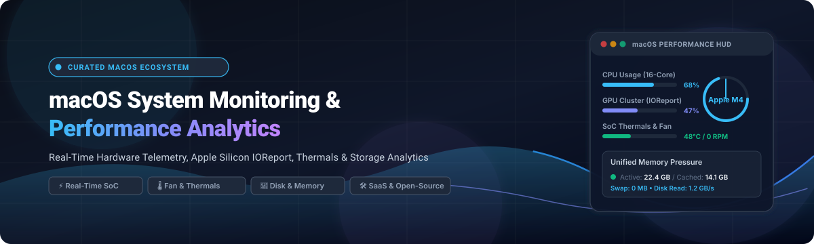

# Awesome macOS System Monitoring & Performance Analytics

<p align="center">
  
</p>

<p align="center">
  <a href="https://github.com/sindresorhus/awesome"></a>
  <a href="https://github.com/ishandutta2007/Awesome-Macos-System-Monitoring-Performance-Analytics/stargazers"></a>
  <a href="https://github.com/ishandutta2007/Awesome-Macos-System-Monitoring-Performance-Analytics/blob/main/LICENSE"></a>
  <a href="https://github.com/ishandutta2007/Awesome-Macos-System-Monitoring-Performance-Analytics"></a>
</p>

A curated directory and comparative landscape of top **SaaS platforms, commercial utilities, and open-source GitHub projects** dedicated to **macOS System Monitoring & Performance Analytics**. Explore tools for real-time Apple Silicon (M1/M2/M3/M4) and Intel CPU/GPU tracking, unified memory pressure, storage diagnostics, thermal throttling prevention, fan curve management, and network telemetry.

---

## Table of Contents

- [Sector Overview & Market Dynamics](#sector-overview--market-dynamics)
- [SaaS & Commercial Utility Platforms](#saas--commercial-utility-platforms)
- [Open-Source GitHub Projects](#open-source-github-projects)
- [Key macOS Telemetry Technologies & Frameworks](#key-macos-telemetry-technologies--frameworks)
- [How to Choose the Right Tool](#how-to-choose-the-right-tool)
- [How to Contribute](#how-to-contribute)
- [Disclaimer](#disclaimer)

---

## Sector Overview & Market Dynamics

The desktop system utility and endpoint performance monitoring market is estimated at **$450M to $1.2B**, while the broader infrastructure observability and endpoint analytics sector exceeds **$18B to $40B+** globally with a 9–14% CAGR. 

This sector is **moderately fragmented**: built-in OS utilities (such as Apple's Activity Monitor and `powermetrics`) establish a universal baseline, while commercial vendors (like MacPaw's CleanMyMac) capture mainstream consumer cleaning and optimization; concurrently, an active indie studio and open-source ecosystem dominates power-user menu bar telemetry and granular Apple Silicon hardware diagnostics.

---

## SaaS & Commercial Utility Platforms

The following table compares leading commercial and SaaS software solutions for macOS system diagnostics, performance analytics, and storage health. The table is ranked by company size (valuation / estimated annual revenue, descending).

| Product | Developer / Company | Company Size (Valuation / Revenue) | Starting Price | Free Tier / Trial Limit | Key Focus & Platform Features |
| :--- | :--- | :--- | :--- | :--- | :--- |
| **[Activity Monitor](https://support.apple.com/guide/activity-monitor/)** | Apple Inc. | ~$3.8T – $5.1T Market Cap / ~$391B Ann. Revenue | $0.00 (Pre-installed with macOS) | Free forever (Native built-in OS utility; 100% features available with zero license constraints) | Native macOS system monitor tracking CPU load, unified memory pressure, energy consumption, disk I/O, and network processes. |
| **[CleanMyMac](https://macpaw.com/cleanmymac)** | MacPaw Inc. | ~$90M+ Annual Revenue (Privately Held) | $39.95/year (1 Mac) or $9.95/month | 7-day free trial (Full suite access with unlimited scans; post-trial requires subscription or $89.99 lifetime license) | Complete macOS optimization and system health dashboard with live menu bar resource trackers, malware scanning, and space cleanup. |
| **[MacBooster](https://www.macbooster.net/)** | IObit | ~$15M – $28M Annual Revenue (Privately Held) | $24.95/year (1 Mac) | Free forever scan-only plan (Full diagnostic system scanning supported; fixing or cleanup actions require purchase) | Comprehensive system cleaner, malware remover, memory booster, and hardware performance optimizer. |
| **[DaisyDisk](https://daisydiskapp.com/)** | Software Ambience Corp. | ~$1M – $5M Est. Revenue (Bootstrapped Indie Studio) | $9.99 one-time purchase | Free forever scan & map plan (Visual sunburst disk usage map enabled; in-app batch file deletion and cloud scanning locked) | Interactive visual disk space analyzer providing real-time storage breakdowns for internal drives, external SSDs, and cloud storage. |
| **[iStat Menus](https://bjango.com/mac/istatmenus/)** | Bjango Pty Ltd | ~$1M – $3M Est. Revenue (Bootstrapped Indie Studio) | $11.99 one-time purchase | 14-day free trial (Fully functional access to all menu bar modules, dropdown telemetry, and sensors without feature gates) | Legendary menu bar telemetry suite tracking per-core CPU, GPU engines, memory pressure, disk activity, network throughput, battery, and fans. |
| **[Sensei](https://cindori.com/sensei)** | Cindori AB | ~$500K – $2M Est. Revenue (Independent Studio) | $29.00/year or $59.00 one-time | 14-day free trial (Unrestricted access to hardware monitor, SSD health SMART stats, GPU metrics, and uninstaller tools) | Next-generation Mac optimization app delivering thermal monitoring, detailed fan speed controls, SSD performance benchmarks, and TRIM management. |
| **[TG Pro](https://www.tunabellysoftware.com/tgpro/)** | Tunabelly Software | ~$300K – $1.5M Est. Revenue (Micro-ISV) | $10.00 one-time purchase | 14-day free trial (Full hardware sensor monitoring and automated fan curve rules; licenses require one-time fee) | Specialized thermal management utility with diagnostics for every internal temperature sensor, Apple Silicon SoC monitoring, and fan overrides. |
| **[MenuBar Stats](https://seense.com/menubarstats/)** | seense (Fabrice Leyne) | <$1M Est. Revenue (Solo Indie Developer) | $4.99 one-time purchase | Free download evaluation (Basic system monitoring modules active; advanced plugins and multi-window views require full license) | Modular menu bar system monitor featuring detachable windows and dedicated monitoring plugins for CPU, memory, disk, network, and GPU. |

---

## Open-Source GitHub Projects

Explore community-driven, transparent, and telemetry-free system monitors for macOS. The repositories below are sorted by **GitHub Star Count** (descending) with social badges linked directly to each project's stargazers.

| Project & Repo | Stars | Language | Primary Architecture / Interface | Description |
| :--- | :---: | :--- | :--- | :--- |
| **[Netdata](https://github.com/netdata/netdata)** | [](https://github.com/netdata/netdata/stargazers) | C / Go | Web Dashboard & Daemon (macOS / Linux) | High-fidelity, real-time distributed infrastructure and per-second system performance monitor with pre-configured macOS metrics collection. |
| **[Stats](https://github.com/exelban/stats)** | [](https://github.com/exelban/stats/stargazers) | Swift | Menu Bar & macOS Widgets | The definitive open-source macOS menu bar monitor: CPU, GPU, unified memory, disk, network, battery, sensors, and fan speeds. |
| **[btop](https://github.com/aristocratos/btop)** | [](https://github.com/aristocratos/btop/stargazers) | C++ | Terminal (TUI) | Modern terminal resource monitor with responsive graphs for CPU cores, memory utilization, disk I/O, network bandwidth, and process tree. |
| **[Glances](https://github.com/nicolargo/glances)** | [](https://github.com/nicolargo/glances/stargazers) | Python | CLI, Web UI & REST API | Cross-platform curses-based monitoring tool providing an eye on system resources with Docker integration, client/server mode, and export to Prometheus. |
| **[duf](https://github.com/muesli/duf)** | [](https://github.com/muesli/duf/stargazers) | Go | Terminal (CLI) | User-friendly disk usage utility for macOS and Linux that renders color-coded storage tables, filesystem block stats, and JSON output. |
| **[bottom](https://github.com/ClementTsang/bottom)** | [](https://github.com/ClementTsang/bottom/stargazers) | Rust | Terminal (TUI) | Ultra-fast, customizable graphical process and system monitor written in Rust with configurable visual layouts, temperature tracking, and zoomable charts. |
| **[gopsutil](https://github.com/shirou/gopsutil)** | [](https://github.com/shirou/gopsutil/stargazers) | Go | Library / Framework | Port of Python's psutil to Go, providing foundational APIs for querying macOS CPU, memory, disks, network interfaces, and host sensors. |
| **[nvtop](https://github.com/Syllo/nvtop)** | [](https://github.com/Syllo/nvtop/stargazers) | C | Terminal (TUI) | Interactive GPU process monitor supporting Apple Silicon unified GPUs (via IOReport), NVIDIA, AMD, and Intel graphic engines. |
| **[eul](https://github.com/gao-sun/eul)** | [](https://github.com/gao-sun/eul/stargazers) | Swift | Menu Bar & SwiftUI Widgets | Minimalist macOS status monitoring widget written in SwiftUI with dark mode support, Bluetooth battery tracking, and CPU/RAM display. |
| **[htop](https://github.com/htop-dev/htop)** | [](https://github.com/htop-dev/htop/stargazers) | C | Terminal (TUI) | Interactive process viewer and terminal monitor with horizontal scrolling, tree views, kill signals, and full macOS compatibility via Homebrew. |
| **[gotop](https://github.com/cjbassi/gotop)** | [](https://github.com/cjbassi/gotop/stargazers) | Go | Terminal (TUI) | Terminal-based graphical activity monitor with sparkline charts, network bandwidth meters, and temperature status. |
| **[OnlySwitch](https://github.com/jacklandrin/OnlySwitch)** | [](https://github.com/jacklandrin/OnlySwitch/stargazers) | Swift | Menu Bar Utility | Multi-tool macOS menu bar companion featuring built-in system resource monitors alongside fast hardware switches and Shortcuts execution. |
| **[asitop](https://github.com/tlkh/asitop)** | [](https://github.com/tlkh/asitop/stargazers) | Python | Terminal (CLI) | Performance monitor specifically built for Apple Silicon (M1/M2/M3/M4) leveraging `powermetrics` to display CPU/GPU wattage, neural engine bandwidth, and temperatures. |
| **[Hot](https://github.com/macmade/Hot)** | [](https://github.com/macmade/Hot/stargazers) | Swift | Menu Bar Utility | Lightweight menu bar application designed to monitor CPU speed limitation, thermal throttling states, and processor temperature in real time. |
| **[iGlance](https://github.com/iglance/iGlance)** | [](https://github.com/iglance/iGlance/stargazers) | Swift | Menu Bar Utility | Free macOS status bar utility displaying CPU, memory, fan speed, battery health, and network statistics with minimal system overhead. |
| **[macos-sysdata](https://github.com/Jarvis322/macos-sysdata)** | [](https://github.com/Jarvis322/macos-sysdata/stargazers) | Swift | Menu Bar App | Granular macOS "System Data" storage analyzer and cleaner that displays underlying Terminal commands before safely deleting bloated caches. |
| **[mactop](https://github.com/context-labs/mactop)** | [](https://github.com/context-labs/mactop/stargazers) | Go | Terminal (TUI) | Terminal-based monitor for Apple Silicon Macs displaying real-time power consumption, CPU/GPU core usage, and thermal states. |
| **[SysWatch](https://github.com/matthart1983/syswatch)** | [](https://github.com/matthart1983/syswatch/stargazers) | Python | Terminal (TUI) | Tabbed terminal diagnostics utility for CPU, memory, GPU, disk, and network with diagnostic session recording and replay capabilities. |
| **[AirStats](https://github.com/byrencheema/airstats)** | [](https://github.com/byrencheema/airstats/stargazers) | Swift | Menu Bar & Desktop Widget | Ultra-lightweight menu bar telemetry app requiring ~0.046% CPU, covering thermals, GPU, RAM, disk, and battery life. |
| **[dshb](https://github.com/beltex/dshb)** | [](https://github.com/beltex/dshb/stargazers) | Swift | Terminal (CLI) | macOS system monitor for the terminal written in Swift, surfacing Mach kernel statistics, battery states, and thermal sensors. |
| **[Mectrics](https://github.com/farukkamcici/mectrics)** | [](https://github.com/farukkamcici/mectrics/stargazers) | Swift | Menu Bar & Headless CLI | Privacy-centric system monitor featuring alert thresholds, attention logs, and an automation-friendly headless CLI with zero telemetry. |
| **[MacMonitor](https://github.com/ryyansafar/MacMonitor)** | [](https://github.com/ryyansafar/MacMonitor/stargazers) | Swift | Menu Bar & Desktop Widget | Apple Silicon hardware monitor with per-core CPU meters, IOReport-powered GPU tracking, and battery cycle inspection. |
| **[Vulcan](https://github.com/Gui-Oba/Vulcan)** | [](https://github.com/Gui-Oba/Vulcan/stargazers) | Python / React | Web Dashboard | Modern web-based macOS system monitor featuring CPU heatmaps, real-time geolocation of active network connections, and energy footprint metrics. |

---

## Key macOS Telemetry Technologies & Frameworks

When building or benchmarking monitoring systems on macOS, these kernel interfaces and command-line tools form the foundation of metric extraction:

* **`powermetrics`**: Apple's native command-line utility for reading Apple Silicon SoC energy, per-cluster frequency, Neural Engine usage, and SMC thermal states.
* **`IOReport` / `IOKit`**: Private and semi-documented Apple frameworks that expose hardware performance counters, fan RPM, battery cycles, and GPU power draw.
* **`vm_stat` / `sysctl`**: Mach subsystem APIs for tracking unified memory page-ins, compressed memory, swap usage, and CPU architecture topology.
* **`fs_usage` / `sc_usage`**: Low-level kernel tracers for disk file system calls and network socket activity.
* **`Activity Monitor.app`**: Standard system application serving as the baseline ground truth for OS process management.

---

## How to Choose the Right Tool

```
                        What is your primary use case?
                                      |
         +----------------------------+----------------------------+
         |                                                         |
[Menu Bar At-A-Glance]                                    [Terminal / CLI Diagnostics]
         |                                                         |
         +--> Want full customization?                             +--> Want visual charts?
         |    • Commercial: iStat Menus ($11.99)                   |    • btop / bottom
         |    • Open Source: Stats (Swift, Free)                   |
         |                                                         +--> Apple Silicon Power / SoC Wattage?
         +--> Pure Thermal / Throttle Alert?                       |    • asitop / mactop
         |    • TG Pro ($10.00) / Hot (Free OSS)                   |
         |                                                         +--> Headless / Remote Telemetry?
         +--> Storage & "System Data" Cleanup?                          • Netdata / Glances
              • DaisyDisk ($9.99) / macos-sysdata (Free OSS)
```

---

## How to Contribute

Contributions, feature additions, and corrections are welcome!

1. **Fork the repository** on GitHub.
2. **Add or update an entry** in `README.md` keeping the tabular structure intact.
3. Ensure you provide:
   * **For SaaS/Commercial tools**: Exact starting pricing, explicit free trial / free tier limits, developer size, and primary capabilities.
   * **For Open-Source tools**: Repository URL, valid GitHub star badge (`style=social&color=white`), programming language, and platform scope.
4. **Submit a Pull Request** with a clear title and description of changes.

---

## Disclaimer

* This repository is a community-curated, independent compilation for educational and diagnostic purposes. It is not affiliated with, authorized, maintained, or sponsored by Apple Inc. or any of the listed third-party software vendors.
* macOS system monitoring utilities frequently require system permissions such as Accessibility, Full Disk Access, or Privileged Helper Daemons. Always audit software permissions and verify releases before installation.
* Fan control overrides and thermal management settings should be used responsibly to prevent hardware damage.

---

<p align="center">
  <b>Built for Mac power users, software engineers, DevOps admins, and hardware enthusiasts.</b><br />
  Star ⭐ this repo if it helps you keep your Mac fast, cool, and transparent!
</p>
